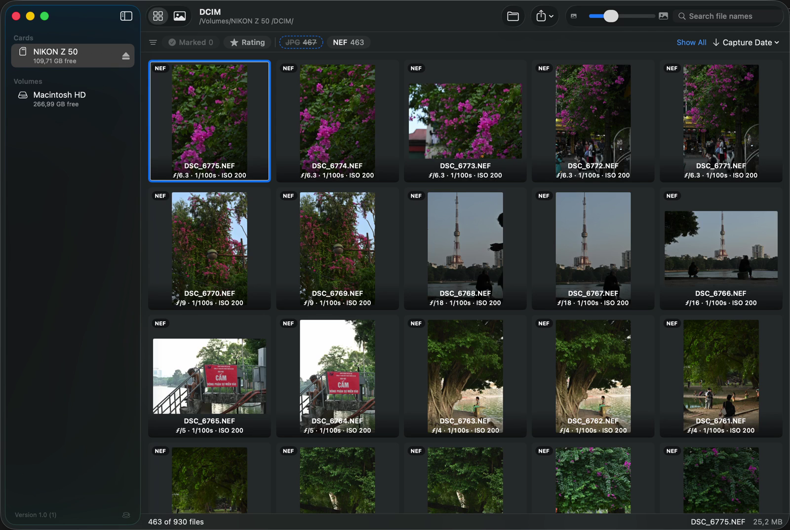

# RawPreview

**From the card to your phone.** A free, open source macOS app for photographers: insert an SD card, mark the keepers, apply a preset and AirDrop them as JPEGs. No catalog, no import, no export.



## Features

- **Preview a card straight away.** Thumbnails appear as soon as the card mounts, and files stay where they are. RAW, JPEG, HEIF and video share one grid.
- **Cull from the keyboard.** Press 1–5 to rate and S to mark a photo for copy. Stars go into `.xmp` sidecars, which Lightroom Classic and Capture One read.
- **451 built-in presets.** Hover to preview, click to apply, press `\` to compare with the original. You can also import Lightroom `.xmp` and `.lrtemplate` presets.
- **Share to your phone.** AirDrop the keepers as JPEGs with the preset baked in and GPS removed.
- **Copy only the marked files.** Press ⌘↩, then eject the card.

Presets are applied with RawPreview's own renderer, so results come close to Lightroom without matching it exactly.

**RAW formats:** the app reads 19 RAW formats from the major camera makers, including NEF, CR2, CR3, ARW, RAF and DNG. The full list is in [MediaKind.swift](rawpreview/Models/MediaKind.swift).

## Install

Requires macOS 14 Sonoma or later, on Apple Silicon or Intel.

1. Download the latest DMG from [Releases](https://github.com/khanvt001/rawpreview/releases).
2. Drag RawPreview to Applications.
3. Open it. The app isn't notarized by Apple yet, so macOS blocks the first launch. Go to System Settings → Privacy & Security, then click **Open Anyway** next to "RawPreview" was blocked. You only need to do this once.

## Build from source

You need Xcode 26 and its Metal toolchain, which is a separate download:

```sh
xcodebuild -downloadComponent MetalToolchain
```

Then open `rawpreview.xcodeproj` and run the `rawpreview` scheme. No Apple Developer account is needed: the default build is ad-hoc signed and has analytics off.

To sign with your own team, copy `Config/Local.xcconfig.example` to `Config/Local.xcconfig` and fill it in. Without a team, macOS asks for access to removable volumes again after each rebuild.

To build a DMG, run `scripts/build_dmg.sh`. The result is in `build/`.

## Privacy

RawPreview works offline and your photos never leave your Mac unless you share them.

Official builds send anonymous usage counts to [Aptabase](https://aptabase.com). This is **on by default**, and you can turn it off in Settings:

| Event | What is sent |
| --- | --- |
| App launch | That the app started |
| Photos copied | How many, and whether a preset was used |
| Photos shared | How many, how they were shared, and whether a preset or edits were used |

Each event also carries the app version, macOS version and locale. File names, folders and photos are never sent. Builds from source send nothing unless you add your own Aptabase key. The code is in [Analytics.swift](rawpreview/Services/Analytics.swift).

## Contributing

Bug reports and pull requests are welcome. See [CONTRIBUTING.md](CONTRIBUTING.md). To report a security issue, see [SECURITY.md](SECURITY.md).

## License

The source code is under the [MIT License](LICENSE). That license doesn't cover:

- the RawPreview name and app icon, so please use your own for a fork you distribute
- the media in `marketing/` ([details](marketing/README.md))
- third-party components ([details](THIRD_PARTY_NOTICES.md))

RawPreview is an independent project and isn't affiliated with Adobe, or with any camera or film brand, photographer or app named in it.

Built-in presets come from [Emulsion Presets](https://github.com/peva3/EmulsionPresets) by peva3.
